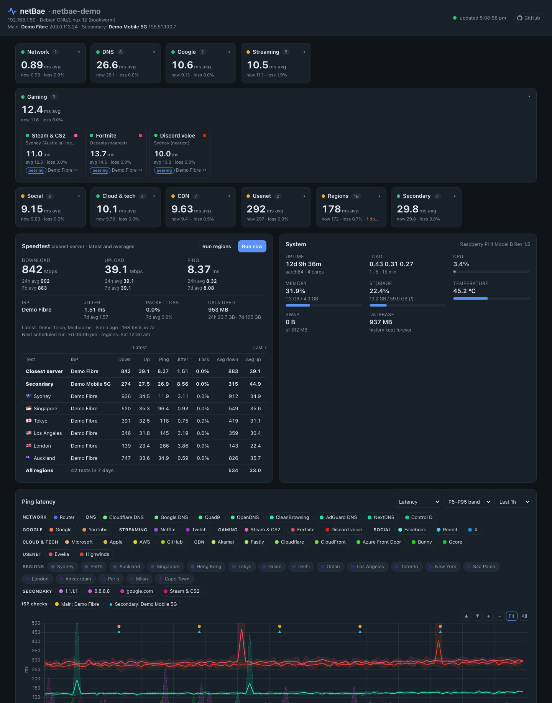

<div align="center">

# netBae

<sub>by <a href="https://github.com/jchin14">jchin14</a></sub>

**A self-hosted dashboard for your home internet connection.**<br>
Ping, DNS, game servers and speedtests, recorded around the clock on a Raspberry Pi, a Linux VM, a Mac or a Windows PC.




</div>

## Why netBae

Your ISP's status page says everything is fine, but your game lagged, the video call dropped and the evening stream buffered. netBae keeps a record of what your connection was actually doing, so you can see when it was slow, how slow and where the problem was.

- **Latency to everything that matters:** your router, DNS resolvers, Google/YouTube, Netflix/Twitch, Facebook/Instagram/Reddit/X, AI (ChatGPT, Claude, Grok), Microsoft/Apple/AWS/GitHub, CDNs (Akamai, Fastly, Cloudflare, CloudFront, Azure Front Door, Bunny, Gcore), Usenet in the US and Europe (Omicron/Newshosting, Easynews, Giganews, UsenetExpress, Frugal, Eweka, Usenet.Farm) and **game servers** (Steam & CS2, Fortnite, Discord voice), every 5 seconds
- **Grouped overview:** one card per category with its average ping. Click a card to see every host in it.
- **Charts that show jitter:** the average as a solid line with a shaded P5–P95 (or min–max) band. The y-axis fits the averages, and you can zoom and drag. When there's only a little data (a new install or a newly added host), the time axis zooms in to it.
- **Speedtests** with the official [Ookla Speedtest CLI](https://www.speedtest.net/apps/cli): download, upload, ping, jitter, packet loss, ISP and data used, with 24-hour and 7-day averages
- **Worldwide view:** latency to 18 cities (London, New York, Tokyo, Singapore …), plus optional speedtests to them
- **Which ISP you're on:** the public IP and ISP of each connection, checked every 10 minutes and marked on the charts, so failovers stand out
- **Routes and transit providers:** every 12 hours (and right after netBae starts, for anything without a recent route) netBae traces the route to each target and shows whether it's **on-net**, a **direct** connection to the destination's network, handed over at an **IX** (internet exchange, named) or **transit** via carriers like Cogent, Arelion, GTT or Vodafone. Each hand-over is labelled **peering** or **paid transit**, and every hop and hostname is one click away
- **Secondary connection monitoring:** test a second internet connection (e.g. a 5G/4G failover link) alongside your main one, at the same time
- **DNS over IPv4 and IPv6:** response times for your router, the DNS servers DHCP gave you, and Cloudflare, Google, Quad9, OpenDNS, CleanBrowsing, AdGuard, NextDNS and Control D
- **History kept forever,** at the right resolution: every ping for 7 days, 1-minute summaries for 90 days, hourly summaries for ever
- **Works from any device** on your network, including when the internet is down
- **Light and dark themes:** follows your device, or pick one with the switch in the header (remembered per browser)
- **No Docker, no dependencies:** Python's standard library and SQLite. One command installs or updates it.

## Quick start

On a Raspberry Pi, a Linux VM (Proxmox, etc.) or a Mac:

```bash
curl -fsSL https://raw.githubusercontent.com/jchin14/netBae/main/install.sh | sudo bash
```

On Windows 10/11, in **PowerShell as Administrator**:

```powershell
irm https://raw.githubusercontent.com/jchin14/netBae/main/install.ps1 | iex
```

Or with **Docker** (Linux):

```bash
docker run -d --name netbae --network host --restart unless-stopped \
  -e TZ=Australia/Melbourne -v netbae-data:/data ghcr.io/jchin14/netbae:latest
```

Then open **`http://<that-machine>/`** on your phone or laptop. Run the same command again any time to update; your config and history are kept.

| | Supported |
|---|---|
| **Linux** | Raspberry Pi OS, Debian, Ubuntu, Fedora, RHEL/Rocky/Alma, Arch, openSUSE (systemd) on x86_64, arm64, armhf, armv6, i386 |
| **macOS** | 12 Monterey or later, Apple silicon or Intel (uses Homebrew) |
| **Windows** | 10 and 11 (and Server 2019+), x64 or arm64, with its own PowerShell installer (`install.ps1`) |
| **Docker** | Linux hosts (Pi, NAS, Proxmox, servers) on amd64, arm64 and arm/v7, with host networking |

<details>
<summary><b>What the installer does on Linux</b></summary>

1. installs `python3`, `ping` and `curl` with your package manager
2. installs the official Ookla Speedtest CLI from Ookla's package repository (Debian/Ubuntu/Pi OS, Fedora/RHEL), so it updates with your system, or from Ookla's release tarball elsewhere. The unofficial Python `speedtest-cli` is removed, since it conflicts.
3. creates an unprivileged `netbae` user and installs the app to `/opt/netbae`
4. writes `/etc/netbae/config.toml` (an existing config is never overwritten)
5. starts the `netbae` systemd service on port 80 without running as root (via `CAP_NET_BIND_SERVICE`). If something else already uses the port, it takes the next free one (81, 82 …), saves it in the config and tells you
6. opens the port in `ufw`/`firewalld` if either is active, and installs the `netbae` command

On Proxmox, use a VM or a *privileged* LXC container; unprivileged LXC can block ping.
</details>

<details>
<summary><b>What the installer does on macOS</b></summary>

Install [Homebrew](https://brew.sh) first, then run the Quick start command in Terminal and enter your Mac password when `sudo` asks. The dashboard is at `http://<your-mac>.local/` (the installer prints the exact address). The installer:

1. uses (or `brew install`s) a Python 3.11+; macOS's own `python3` is too old
2. installs the Ookla CLI from Ookla's Homebrew tap (`teamookla/speedtest`). Homebrew always runs as your user, never as root.
3. creates a hidden `_netbae` user and installs the app to `/usr/local/lib/netbae`
4. writes `/usr/local/etc/netbae/config.toml`
5. starts a launchd LaunchDaemon (`com.github.netbae`) on port 80 (or the next free port, saved in the config), so it runs from boot with nobody logged in, still as an unprivileged user
6. allows Python through the macOS firewall if it's on

Tips: stop the Mac from sleeping (System Settings → Energy), and use Ethernet so the charts measure your internet rather than your Wi-Fi. If you turn the macOS firewall on later, re-run the install command so other devices can still reach the dashboard. Temperature isn't available on macOS without root. `netbae uninstall` leaves the speedtest CLI installed; `brew uninstall speedtest` removes it.
</details>

<details>
<summary><b>What the installer does on Windows</b></summary>

`install.sh` is a bash script built around systemd and launchd, and a stock Windows has neither, so Windows gets `install.ps1`, written for the Windows PowerShell that every Windows 10/11 already has. From a clone, run `powershell -ExecutionPolicy Bypass -File install.ps1`; from a non-admin window it asks for admin rights (UAC) and continues in a new window. It:

1. uses an installed Python 3.11+, or installs Python 3.12 with `winget` (or the python.org installer if winget is missing)
2. installs the official Ookla CLI with `winget` (`Ookla.Speedtest.CLI`) or from Ookla's zip, and keeps a copy in `C:\Program Files\netBae\speedtest` that the service account can run
3. installs the app to `C:\Program Files\netBae` and puts the `netbae` command on the PATH (works in cmd and PowerShell)
4. writes `C:\ProgramData\netBae\config.toml` (an existing config is never overwritten)
5. registers a scheduled task (`netBae`) that starts at boot with nobody logged in, as the unprivileged built-in *LOCAL SERVICE* account, and comes back within 5 minutes if it ever stops. A real Windows service would need pywin32 or a wrapper exe; a task needs nothing extra.
6. allows the port in Windows Firewall from your local network only. Port 80 is often taken on Windows (IIS, http.sys); the installer then moves to the next free port (81, 82 …), saves it in the config and tells you.

`netbae uninstall -Purge` removes everything, including the task, firewall rule and PATH entry; Python and a winget-installed speedtest CLI are left alone.

Tips: turn off sleep (Settings → System → Power). Load average and temperature aren't available on Windows; CPU, RAM, page file, storage and uptime are. For a [secondary connection](#monitoring-a-secondary-connection), `bind` must be an IP address (Windows `ping` can't pick an interface by name).

**WSL2?** You could run the Linux installer inside WSL2, but it makes a poor monitor: WSL2 sits behind its own NAT, so `gateway` is the WSL virtual switch rather than your router and every ping has an extra hop; other devices can't reach the dashboard without port forwarding or mirrored networking; and WSL only runs while something keeps it alive. Use the native installer instead.
</details>

<details>
<summary><b>Running it with Docker</b></summary>

Use the [docker-compose.yml](docker-compose.yml) in this repo (`docker compose up -d`), or the `docker run` command above. Images: `ghcr.io/jchin14/netbae` for amd64, arm64 (Pi 3/4/5 on 64-bit) and arm/v7 (32-bit Pi OS).

- **Use host networking** (`network_mode: host` / `--network host`). In Docker's default bridge network every test goes through Docker's NAT, so "Router" would be Docker's gateway, routes would start inside Docker, DHCP DNS would show Docker's resolver, and secondary connections couldn't bind to the host's IPs. netBae detects this and shows a warning on the dashboard.
- **Set `TZ`** to your timezone: speedtest times and offsets follow it.
- **`/data`** holds `config.toml` (created from the defaults on first start; edit it and `docker restart netbae`) and the history database. Back up that volume to keep your history.
- **Disk usage:** add `-v /:/host:ro` to show the host's disk instead of the container's.
- **Port:** host networking uses port 80 on the host; set `-e NETBAE_PORT=8080` before the first start (or change `[web] port` in `/data/config.toml`) if something else uses 80.
- **Update:** `docker pull ghcr.io/jchin14/netbae:latest` and recreate the container (`docker compose pull && docker compose up -d`).
- **Docker Desktop on Mac/Windows** runs containers in a hidden VM, so host networking there means the VM's network. It works, but the native installers above measure your connection more accurately.
</details>

<details>
<summary><b>Where things live</b></summary>

| | Linux | macOS | Windows |
|---|---|---|---|
| App | `/opt/netbae` | `/usr/local/lib/netbae` | `C:\Program Files\netBae` |
| Config | `/etc/netbae/config.toml` | `/usr/local/etc/netbae/config.toml` | `C:\ProgramData\netBae\config.toml` |
| Database | `/var/lib/netbae/netbae.db` | `/usr/local/var/netbae/netbae.db` | `C:\ProgramData\netBae\netbae.db` |
| Log | `journalctl -u netbae` | `/usr/local/var/log/netbae.log` | `C:\ProgramData\netBae\netbae.log` |
| Service | systemd `netbae.service` | launchd `com.github.netbae` | scheduled task `netBae` |
</details>

## Everyday use

```bash
netbae update        # update to the latest version (or re-run the install command)
netbae status        # is it running?
netbae logs          # follow the log
netbae config        # edit the config, validate it and restart
netbae check         # validate the config and show the next speedtest times
netbae restart       # also start / stop
netbae uninstall     # remove (add --purge to also delete config + history; -Purge on Windows)
```

On Windows, commands that change something (update, restart, config, uninstall) ask for admin rights.

When an update adds new options or default targets, your config isn't overwritten. The latest defaults are saved next to it as `config.toml.default`.

## Configuration

Everything lives in one commented [config file](config.toml). The highlights:

| Setting | Default | |
|---|---|---|
| `[web] port` | `80` | if it's taken when netBae starts, the next free port is used and the log says which (`netbae logs`) |
| `[ping] targets` | 41 hosts in 11 groups | `{ name, host, group }`; `host = "gateway"` = your router; `method = "tcp"` for hosts that block ping |
| `[ping] interval_seconds` / `offset_seconds` | `5` / `0` | |
| `[ping] regions` | 18 cities | latency to the fastest Ookla server in each city, every `region_interval_seconds` (30) |
| `[dns] servers` / `domains` | router, DHCP DNS + 8 public resolvers over IPv4 and IPv6 / 5 domains | `host = "dhcp"` adds the DNS servers this machine got from DHCP if they differ from the router; IPv6 servers are skipped on IPv4-only networks |
| `[speedtest] interval_minutes` / `offset_minutes` | `60` / `0` | e.g. `offset_minutes = 6` → runs at :06 every hour |
| `[speedtest] regions` | none | cities to speedtest, e.g. `["Sydney", "Singapore", "London"]`, once a day by default |
| `[storage]` | `7` / `90` / `0` days | raw samples / 1-minute summaries / hourly summaries (`0` = forever) |
| `[isp] interval_minutes` | `10` | how often each connection's public IP and ISP are checked |
| `[traceroute] interval_hours` | `12` | how often every target's route is traced |
| `[[connections]]` | none | extra internet connections to test, see [below](#monitoring-a-secondary-connection) |

All schedules follow the wall clock (local time), so `interval_minutes = 30` with `offset_minutes = 6` runs at :06 and :36 whenever the service started.

### Game servers

Game companies don't publish servers you can ping, so netBae measures what their own clients use. It picks the server nearest you and shows which one it chose on the tile, e.g. *Sydney (nearest)*.

| Target | What's measured | Pin a region |
|---|---|---|
| `valve:auto` (Steam & CS2) | the nearest [Steam Datagram Relay](https://partner.steamgames.com/doc/features/multiplayer/steamdatagramrelay); CS2 and Dota 2 traffic runs through these | `valve:syd`, `valve:sgp`, `valve:lax`, `valve:fra` … |
| `epic:auto` (Fortnite) | Epic's regional ping beacons, which Fortnite uses to choose a region | `epic:oce`, `naw`, `nac`, `nae`, `eu`, `asia`, `me`, `br` |
| `discord:auto` (Discord voice) | the nearest Discord voice server, from Discord's own latency service | `discord:sydney`, `discord:singapore` … |

**Not possible:** Riot (Valorant, League of Legends) and Activision (Warzone) block ping and connection tests to their game servers, so no tool can measure them from outside the game. Guessed IPs would only give misleading numbers.

### Region speedtests and pings

Built-in cities: 🇦🇺 Sydney, Perth · 🇳🇿 Auckland · 🇸🇬 Singapore · 🇭🇰 Hong Kong · 🇯🇵 Tokyo · 🇬🇺 Guam · 🇮🇳 Delhi · 🇴🇲 Oman · 🇺🇸 Los Angeles, New York · 🇨🇦 Toronto · 🇧🇷 São Paulo · 🇬🇧 London · 🇳🇱 Amsterdam · 🇫🇷 Paris · 🇮🇹 Milan · 🇿🇦 Cape Town.

netBae looks up the Ookla servers in each city, measures them and uses the fastest. It retries the next one if a server fails and refreshes the list daily. Add your own with `{ name = "Frankfurt", city = "Frankfurt", country = "Germany", flag = "DE" }` or `{ name = "Work", server_id = 12345 }`. Ookla has no public servers in mainland China, so Hong Kong is the closest.

Each speedtest can use 0.5–1 GB on a fast connection, so region speedtests are off by default and run daily once enabled. Tests never overlap.

### Monitoring a secondary connection

If you have a second internet connection (for example a 5G/4G link your router fails over to), you can test it at the same time as your main one. netBae sends the secondary connection's tests from a **second IP address** on the monitoring machine, and your router sends traffic from that IP out of the secondary WAN.

**1. Give the machine a second IP address** on your LAN, outside your router's DHCP range:

```bash
# Raspberry Pi OS (bookworm) / NetworkManager
sudo nmcli con mod "Wired connection 1" +ipv4.addresses 192.168.1.51/24 && sudo nmcli con up "Wired connection 1"
```

(netplan: add it under `addresses:`; ifupdown: `up ip addr add 192.168.1.51/24 dev eth0`.)

```bash
# macOS: a second "service" on the same port, with a manual IP (survives reboots)
sudo networksetup -duplicatenetworkservice "Ethernet" "netBae secondary"
sudo networksetup -setmanual "netBae secondary" 192.168.1.51 255.255.255.0 192.168.1.1
```

```powershell
# Windows (admin PowerShell). The adapter must have a static IP: Windows can't add an address to a DHCP adapter.
New-NetIPAddress -InterfaceAlias "Ethernet" -IPAddress 192.168.1.51 -PrefixLength 24 -SkipAsSource $true
```

`-SkipAsSource` stops Windows using the new address for normal traffic; netBae still sends from it when told to.

**2. Route that IP out of the secondary WAN on your router.** A normal *static route* matches the destination, but this needs a **source-based (policy) route**: *source 192.168.1.51 → WAN2*. Routers call it Policy Routing (TP-Link Omada, DrayTek), Policy-Based Routes / Traffic Routes (UniFi), a firewall rule with a gateway (pfSense/OPNsense) or a routing mark (MikroTik). If you can, turn off failover for that rule, so the secondary tests fail when the secondary connection is down instead of quietly using your main connection.

**Alternative:** plug a second network adapter (USB Ethernet or Wi-Fi) into the secondary modem and use its interface name (Linux, e.g. `eth1`; macOS, e.g. `en7`) instead of an IP. On Windows, use the adapter's IP address.

**3. Add the connection** with `netbae config`:

```toml
[[connections]]
name = "Secondary"
bind = "192.168.1.51"          # or an interface: "eth1" on Linux, "en7" on macOS
targets = ["1.1.1.1", "8.8.8.8", "google.com", "valve:auto"]   # or "all": every main ping target
speedtest_interval_minutes = 1440   # daily, to save data on mobile plans (0 = only when you press Run)
```

The connection gets its own group of ping tiles and its own row in the speedtest table, with its ISP and data used, so you can compare it with your main line.

## How it measures

- **Ping:** one ICMP echo per host per interval, using the system `ping`. Hosts that block ping can use a timed TCP connect instead.
- **Router:** `gateway` reads the default route from the kernel (`/proc/net/route`; `route get default` on macOS, `route print` on Windows), so it follows whatever router you're using.
- **Sites:** each name is pinged at the address it resolves to, which for big services is their nearest edge or CDN server. That's the path your real traffic takes.
- **DNS:** one UDP A-record query per resolver and domain, timed in Python, over IPv4 and IPv6. "DHCP DNS" is read from the system's resolver settings (`/etc/resolv.conf` or systemd-resolved on Linux and macOS, the network adapter settings on Windows) at startup.
- **ISP:** an HTTPS request to [ipinfo.io](https://ipinfo.io) through each connection (main and secondary) returns its public IP and ISP. The header shows the current one, and the charts mark every check: one colour per connection and one shape per ISP. Click a marker type above a chart to hide it. ipinfo.io sees your public IP, about 4,500 requests a month per connection at the default interval (its free tier allows 50,000).
- **Routes:** the system `traceroute` (`tracert` on Windows) to each target every 12 hours, and right after netBae starts for any target that has no recent route. Each hop's network comes from [Team Cymru's IP-to-ASN service](https://www.team-cymru.com/ip-asn-mapping) over DNS. A route is **on-net** if the destination is inside your ISP, **direct** if your ISP connects straight to the destination's network (a private interconnect), **IX** if your ISP hands the traffic over across an internet exchange (hops on an exchange's peering LAN, using [PeeringDB](https://www.peeringdb.com)'s prefix list, refreshed daily), even when a transit carrier follows the exchange, and **transit** if your ISP hands it straight to another carrier. Each hand-over is also labelled with the business relationship between the two networks (**peering**, **paid transit**, or **to customer**) from [CAIDA's AS relationships](https://www.caida.org/catalog/datasets/as-relationships/), inferred from public BGP data, published monthly and downloaded once a month (~10 MB on disk). Traceroute only sees routers that answer it, so treat it as a strong hint, not proof.
- **Speedtests:** the official Ookla CLI, auto-selecting the closest server unless you choose one.
- **System:** the model name comes from the device tree on a Raspberry Pi (`/proc/device-tree/model`), DMI/BIOS info on PCs and VMs, `sysctl` on a Mac and the registry on Windows.

## Averages

Averages ignore large outliers, so one bad spike doesn't skew them. Min, max and P95 still show every spike:

- **Ping and DNS:** the fastest and slowest 5% of samples are left out of each average once there are at least 10 samples.
- **Speedtests:** download, upload, ping and jitter averages leave out results beyond 1.5× the interquartile range (e.g. one test that hit a congested server). Packet loss is never trimmed.

## Data storage

History is kept in SQLite at three resolutions:

- every sample for `raw_retention_days` (7)
- 1-minute summaries (count, average, min, max, 5th and 95th percentile) for `minute_retention_days` (90)
- hourly summaries, speedtests and system history for `retention_days` (0 = forever)

Charts automatically use the right one, so a whole year loads instantly even on a Pi. Two reference files sit next to the database and refresh themselves: PeeringDB's internet-exchange prefixes (`peeringdb-ix.json`, daily) and CAIDA's AS relationships (`as-rel-YYYYMM.db`, about 10 MB, monthly). With the defaults, expect a few hundred MB of recent detail plus roughly 30–50 MB per year of long-term history.

## Behind a reverse proxy

netBae works behind Nginx, Caddy, Traefik or Nginx Proxy Manager, on its own hostname or under a sub-path. Caddy:

```
netbae.home.lan {
    reverse_proxy 192.168.1.50:80
}
```

There's no login, so keep it on your LAN. If you need auth, add it at the proxy.

## API

Everything on the dashboard comes from a small JSON API you can use from Home Assistant, Grafana or scripts:
`/api/summary`, `/api/config`, `/api/system`, `/api/system/history`, `/api/ping`, `/api/dns`, `/api/speedtest`, `/api/isp` (query: `from`, `to` in Unix seconds, plus `targets` / `servers` / `domain`), `/api/traceroute?target=<id>` (hops and route history, with each network's relationship to the one before it), and `POST /api/speedtest/run?scope=main|regions|conn:<name>`.

## FAQ

**Does it run on Windows?** Yes, Windows 10 and 11, with `install.ps1` (see [Quick start](#quick-start)). Windows can't run `install.sh` because it has no bash, so it has its own installer.

**How much data does it use?** Pings and DNS are tiny (a few MB a day). Speedtests are what count: each uses roughly what your connection can move in about 20 seconds. On a gigabit line that's about 1 GB per test, so hourly tests add up. The dashboard shows data used per test and per day.

**What's the difference between transit and peering?** Transit is paid access to the whole internet: your ISP pays a carrier like Cogent or GTT to deliver its traffic anywhere. Peering is two networks swapping traffic only between themselves and their own customers, usually for free (sometimes paid when the traffic is lopsided, which still counts as peering). A route that's **direct** or via an **IX** and labelled **peering** is usually the shortest and least congested way in. **Transit** adds another network in the middle. The labels come from CAIDA's data, inferred from public routing tables, so treat them as a well-informed guess.

**Can I show certain groups expanded, e.g. on a wall display?** Open `http://<machine>/?expand=Gaming,DNS`.

**By running speedtests**, you accept [Ookla's EULA and privacy policy](https://www.speedtest.net/about/eula). netBae passes `--accept-license --accept-gdpr` to the CLI.

## Contributing

Pull requests are welcome. See [CONTRIBUTING.md](CONTRIBUTING.md). netBae has no build step: edit, run `python3 app/netbae.py -c <your config>`, refresh. It needs Python 3.8+ with `tomli`, or 3.11+ (the installers set this up; on a Mac, use Homebrew's `python3`).

## Licence

**Free for personal use.** You can install it, modify it and share it, and pull requests are welcome. **Commercial use, use by an educational institution, or selling it or otherwise making money from it needs written permission first.** [Open an issue](https://github.com/jchin14/netBae/issues) to ask. See [LICENSE](LICENSE) for the full terms.
